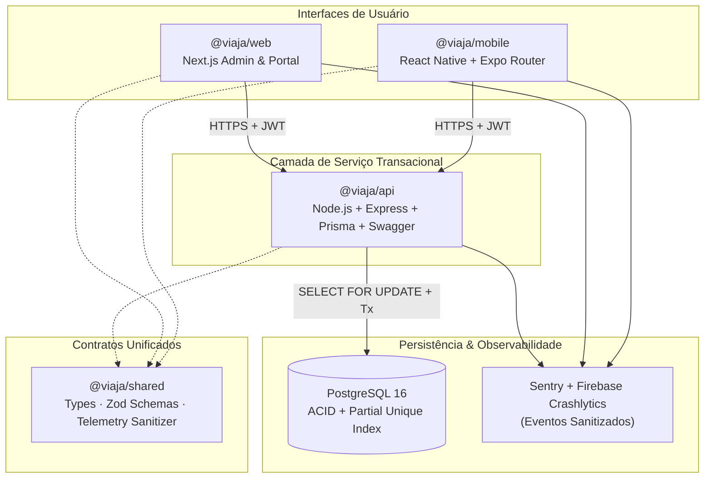
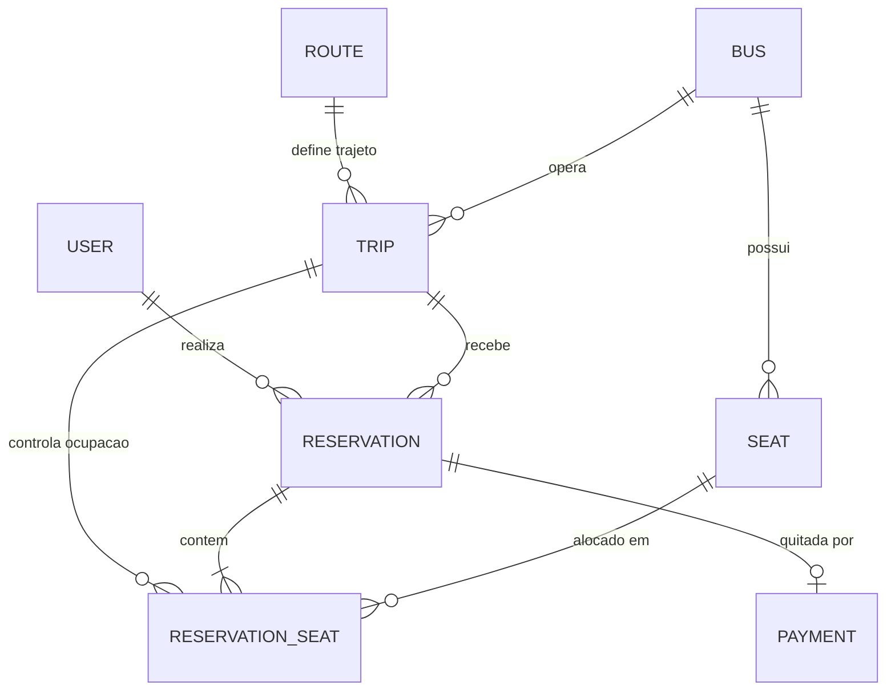
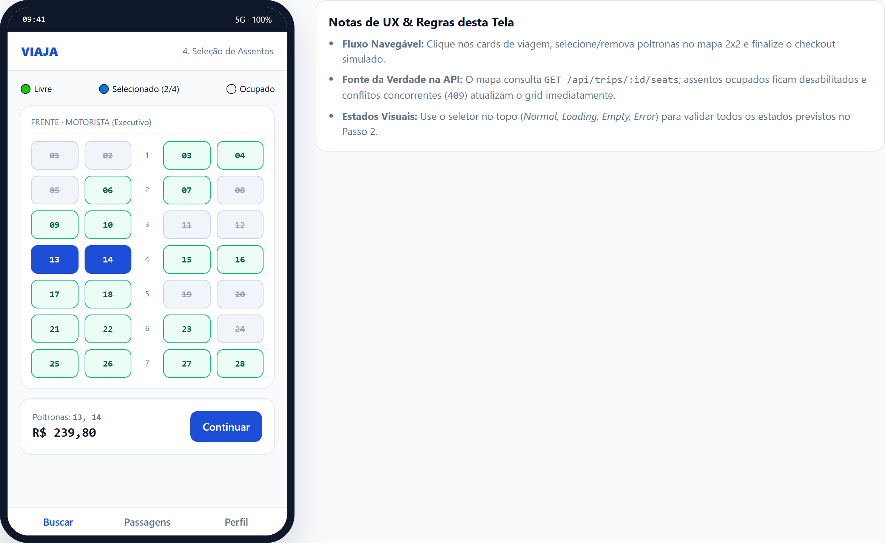
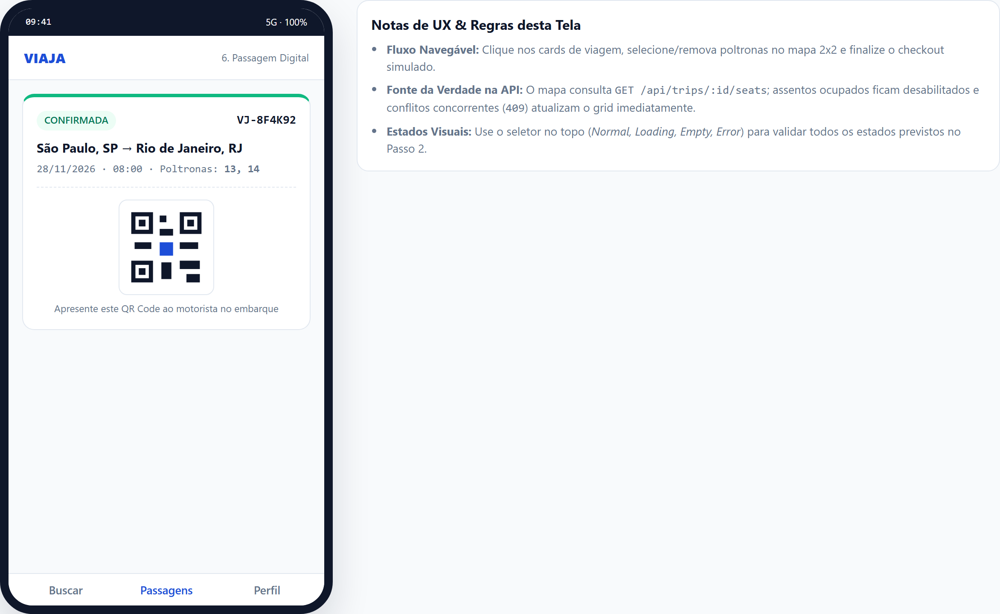
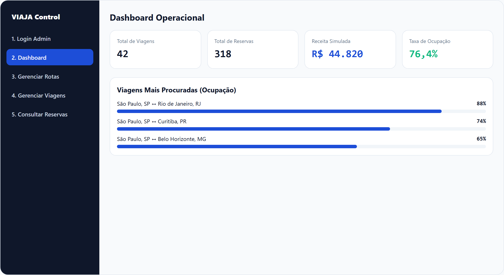
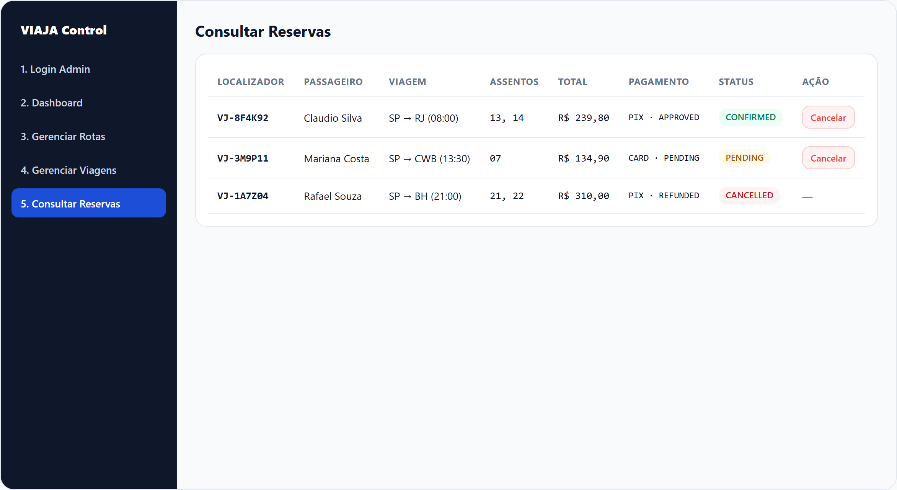

# VIAJA — Plataforma Inteligente de Mobilidade Rodoviária


O **VIAJA** é uma plataforma ponta a ponta de compra e gerenciamento operacional de passagens rodoviárias, construída em um **monorepo TypeScript** que integra um **aplicativo mobile para passageiros (React Native + Expo)**, um **painel web administrativo e portal de reservas (Next.js)** e uma **API REST transacional (Node.js + Express + Prisma + PostgreSQL)**.

---

## 1. Problema Resolvido

Sistemas de transporte rodoviário enfrentam simultaneamente dois desafios críticos:

1. **Experiência em mobilidade:** passageiros em trânsito precisam pesquisar horários, comparar classes de ônibus, visualizar o mapa real do veículo e apresentar um bilhete digital confiável em poucos toques.
2. **Consistência sob alta concorrência (_Double Booking_):** quando múltiplos passageiros disputam a última poltrona livre no mesmo milissegundo, validações superficiais apenas no frontend ou checagens simples `SELECT` antes de `INSERT` geram vendas duplicadas. Além disso, abandonos no checkout não podem bloquear assentos permanentemente.

O **VIAJA** soluciona esse cenário unificando contratos tipados (`@viaja/shared`) e aplicando **defesa em profundidade no banco relacional**: transações explícitas com _locks_ pessimistas ordenados (`SELECT ... FOR UPDATE`), **índice único parcial nativo no PostgreSQL** (`uq_active_trip_seat` para reservas ativas preservando o histórico de cancelamentos) e **expiração automática de reservas pendentes (`expiresAt`)**.

---

## 2. Funcionalidades Principais

### Aplicativo Mobile — Passageiro (`@viaja/mobile`)

- **Autenticação segura:** cadastro, login, renovação transparente de sessão JWT (_refresh token_), revogação no logout e armazenamento criptografado via `Expo SecureStore`.
- **Pesquisa e descoberta de viagens:** busca por origem, destino e data, filtros complementares e ordenação por **menor preço**, **menor duração** ou **horário de partida**.
- **Mapa visual interativo de poltronas (2x2):** estados claros (`Disponível`, `Selecionado`, `Ocupado`), limite de até 4 poltronas por reserva, cálculo em tempo real e sincronização obrigatória com a disponibilidade fresca da API.
- **Checkout simulado:** resumo completo da viagem e pagamento simulado via **PIX** ou **Cartão de Crédito** com atualização transacional imediata.
- **Passagem digital e carteira:** bilhete com código localizador único (`VJ-XXXXXX`), **QR Code de embarque**, histórico de reservas e cancelamento elegível antes da partida.

### Painel Administrativo & Portal Web (`@viaja/web`)

- **Controle de acesso RBAC (`ADMIN`):** rotas protegidas no Next.js e validadas por middleware de autorização na API.
- **Dashboard analítico em tempo real:** indicadores reais de viagens, reservas, receita aprovada, taxa média de ocupação e gráficos interativos (`Recharts`) das rotas/viagens mais procuradas.
- **Gestão operacional de rotas e viagens:** CRUD completo com validação dupla (`React Hook Form` + `Zod`), vínculo de frota (`Bus`), horários, preços em `DECIMAL(10,2)` e bloqueio contra exclusão de rotas em uso.
- **Gestão de reservas e pagamentos:** consulta filtrada por viagem/status, auditoria do pagamento associado e cancelamento administrativo com estorno simulado (`REFUNDED`) e liberação imediata dos assentos.

### Motor Backend & Observabilidade (`@viaja/api` + Infra)

- **API REST documentada com OpenAPI 3.0 / Swagger UI** (`/api/docs` e `/api/docs.json`).
- **Observabilidade _Privacy-by-Design_:** integração com **Sentry** (Backend, Web e Mobile) e **Firebase Crashlytics** (Mobile Expo/EAS) protegida por sanitizador compartilhado que redige senhas, tokens JWT, cartões e PII antes do envio, correlacionando requisições via `x-request-id`.
- **Qualidade e CI/CD:** suíte completa de testes unitários, componentes, integração/concorrência (`10` requisições paralelas sobre o mesmo assento) e E2E (`Playwright`), executada no **GitHub Actions**.

---

## 3. Stack Tecnológica

| Camada                                | Tecnologias                                                                                                                                                     |
| :------------------------------------ | :-------------------------------------------------------------------------------------------------------------------------------------------------------------- |
| **Mobile (`apps/mobile`)**            | React Native `0.76`, Expo `52`, Expo Router `4`, TypeScript, TanStack Query `5`, Zustand `5`, React Hook Form, Zod, Expo SecureStore, `react-native-qrcode-svg` |
| **Web (`apps/web`)**                  | Next.js `14.2` (App Router), React `18`, TypeScript, Tailwind CSS, Primitivos Radix / `shadcn/ui`, TanStack Query `5`, React Hook Form, Zod, Recharts           |
| **Backend (`backend/api`)**           | Node.js `20+`, Express `4`, TypeScript, Prisma ORM `6`, PostgreSQL `16`, JWT (`jsonwebtoken` + `bcryptjs`), Zod, Helmet, Swagger / OpenAPI                      |
| **Compartilhado (`packages/shared`)** | Contratos TypeScript, Schemas `Zod`, Constantes de Domínio e Sanitizador de Telemetria                                                                          |
| **Testes Automatizados**              | Vitest, Supertest, Jest, React Native Testing Library, Testing Library (React), Playwright (Chromium E2E)                                                       |
| **DevOps & Monitoramento**            | pnpm Workspaces, Docker & Docker Compose, GitHub Actions, Sentry (`node`, `nextjs`, `react-native`), Firebase Crashlytics, Vercel, Render Blueprint, Expo EAS   |

---

## 4. Arquitetura do Sistema



### Estrutura do Monorepo

```text
viaja/
├── apps/
│   ├── mobile/          # @viaja/mobile — App para passageiros (Expo Router + EAS)
│   └── web/             # @viaja/web    — Painel administrativo e portal (Next.js)
├── packages/
│   └── shared/          # @viaja/shared — Tipos, schemas Zod e sanitização de telemetria
├── backend/
│   └── api/             # @viaja/api    — API REST modular, Prisma, Dockerfile e testes
├── docs/
│   ├── adr/             # Architecture Decision Records (ADR-0001 a ADR-0006)
│   ├── assets/          # Screenshots das interfaces Mobile e Web
│   ├── prototypes/      # Protótipo interativo autocontido (HTML/CSS/JS)
│   ├── architecture.md  # Escopo, fluxos Mermaid e visão arquitetural
│   ├── database.md      # Modelagem relacional, índices e concorrência
│   ├── api-documentation.md          # Contratos REST e exemplos de payloads
│   ├── testing-strategy.md           # Pirâmide e cenários de testes
│   ├── deployment-and-monitoring.md  # Guia de Sentry, Crashlytics, CI/CD e Deploy
│   ├── demo-guide.md                 # Roteiro cronometrado de demonstração (2-3 min)
│   └── AI_DEVELOPMENT.md             # Governança e validação humana no uso de IA
├── .github/workflows/   # Pipeline CI/CD (GitHub Actions + PostgreSQL 16)
├── docker-compose.yml   # Banco PostgreSQL 16 local com volume persistente
└── render.yaml          # Infraestrutura como código (API Docker + PostgreSQL)
```

---

## 5. Modelagem do Banco de Dados



> **Garantia de Unicidade Concorrente:** A migration inicial cria o índice único parcial `CREATE UNIQUE INDEX uq_active_trip_seat ON reservation_seats (trip_id, seat_id) WHERE is_active = true`, impedindo reservas ativas duplicadas diretamente no motor do PostgreSQL sem perder o histórico de reservas canceladas ou expiradas. Detalhes completos em [`docs/database.md`](./docs/database.md) e no [ADR-0004](./docs/adr/0004-seat-concurrency-and-expiration.md).

---

## 6. Interfaces da Plataforma (Screenshots)

### Aplicativo Mobile — Seleção de Poltronas e Passagem Digital

|                       Mapa Visual de Assentos (2x2)                        |                      Passagem Digital com QR Code                       |
| :------------------------------------------------------------------------: | :---------------------------------------------------------------------: |
|  |  |

### Painel Web Administrativo — Dashboard e Gestão de Reservas

|                       Dashboard Operacional & KPIs                        |                            Gestão de Reservas e Pagamentos                            |
| :-----------------------------------------------------------------------: | :-----------------------------------------------------------------------------------: |
|  |  |

---

## 7. Como Executar Localmente

### Pré-requisitos

- **Node.js** `>= 20`
- **pnpm** `>= 10` (`corepack enable`)
- **Docker** e **Docker Compose**

### Passo a Passo

1. **Clonar o repositório e instalar dependências:**

   ```bash
   git clone https://github.com/claudioc0/Viaja.git
   cd Viaja
   pnpm install
   ```

2. **Configurar variáveis de ambiente locais (já contam com defaults seguros de dev):**

   ```bash
   cp .env.example .env
   cp backend/api/.env.example backend/api/.env
   cp apps/web/.env.example apps/web/.env
   cp apps/mobile/.env.example apps/mobile/.env
   ```

3. **Iniciar o PostgreSQL 16 via Docker, aplicar migrations e popular o seed:**

   ```bash
   pnpm db:up
   pnpm --filter @viaja/api run db:migrate:deploy
   pnpm db:seed
   ```

   > **Credenciais de demonstração geradas pelo seed:**
   >
   > - **Administrador (Web Admin):** `admin@viaja.app` / `Admin@123`
   > - **Passageiro (Mobile & Portal):** `passageiro@viaja.app` / `Viaja@123`

4. **Iniciar os serviços em desenvolvimento:**
   ```bash
   # Terminal 1 — Backend API REST (http://localhost:3333 | Swagger: http://localhost:3333/api/docs)
   pnpm dev:api

   # Terminal 2 — Aplicação Web Next.js (http://localhost:3000)
   pnpm dev:web

   # Terminal 3 — Aplicativo Mobile Expo
   pnpm dev:mobile
   ```

---

## 8. Como Executar os Testes e Checagens de Qualidade

```bash
# Verificação estática completa (TypeScript + ESLint + Prettier)
pnpm typecheck
pnpm lint
pnpm format:check

# Suíte completa (Shared + API Unit/Integration + Mobile RNTL + Web Testing Library)
pnpm test

# Executar camadas individualmente
pnpm test:unit                        # Schemas Zod, sanitização de telemetria e regras de domínio
pnpm test:integration                 # Supertest + PostgreSQL real + disputa concorrente de 10 requisições
pnpm --filter @viaja/mobile run test  # Jest + React Native Testing Library (UI, assentos e telemetria)
pnpm --filter @viaja/web run test     # Vitest + Testing Library (Login, validação e Dashboard KPIs)
pnpm test:e2e                         # Playwright Chromium (Jornadas completas Passageiro & Admin)
```

---

## 9. Demonstração e Documentação Técnica

### Links de Demonstração e Artefatos

- **Documentação Interativa OpenAPI (Swagger UI):** `http://localhost:3333/api/docs` (local) / `/api/docs` no ambiente publicado
- **Protótipo Interativo Navegável (Mobile & Web Admin + Estados de UI):** [`docs/prototypes/index.html`](./docs/prototypes/index.html)
- **Roteiro de Vídeo de Demonstração (2 a 3 min):** [`docs/demo-guide.md`](./docs/demo-guide.md)
- **Blueprint de Deploy Cloud (Vercel + Render + EAS):** [`render.yaml`](./render.yaml) · [`apps/web/vercel.json`](./apps/web/vercel.json) · [`apps/mobile/eas.json`](./apps/mobile/eas.json)

### Índice de Documentação de Engenharia

- [Arquitetura, Escopo e Fluxos do Sistema](./docs/architecture.md)
- [Índice de Architecture Decision Records (ADRs 0001–0006)](./docs/adr/README.md)
- [Modelagem Relacional e Controle de Concorrência](./docs/database.md)
- [Especificação da API REST](./docs/api-documentation.md)
- [Identidade Visual e Design System](./docs/design-system.md)
- [Estratégia de Testes Automatizados](./docs/testing-strategy.md)
- [Monitoramento, CI/CD e Guia de Deploy](./docs/deployment-and-monitoring.md)
- [Convenções de Contribuição e Git Workflow](./CONTRIBUTING.md)
- [Governança de Desenvolvimento Assistido por IA](./docs/AI_DEVELOPMENT.md)
