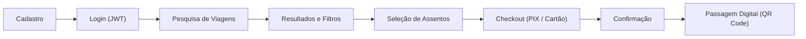
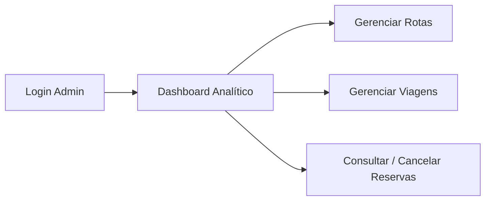
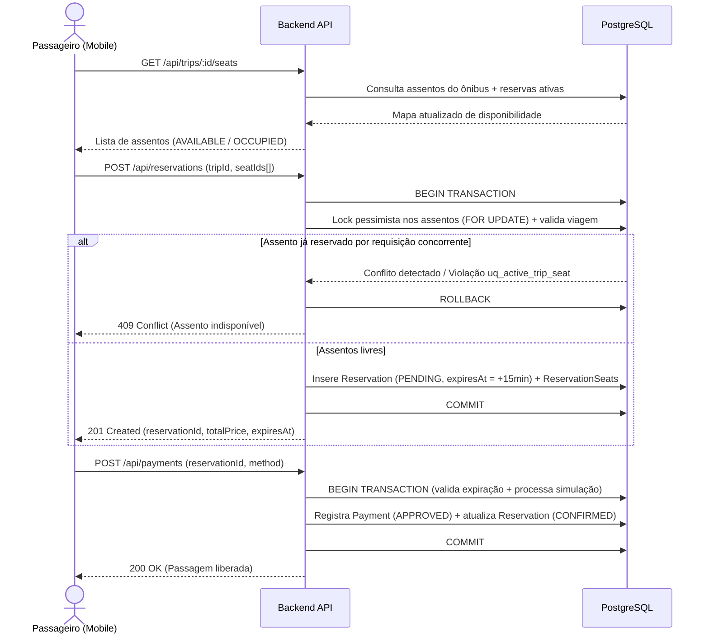
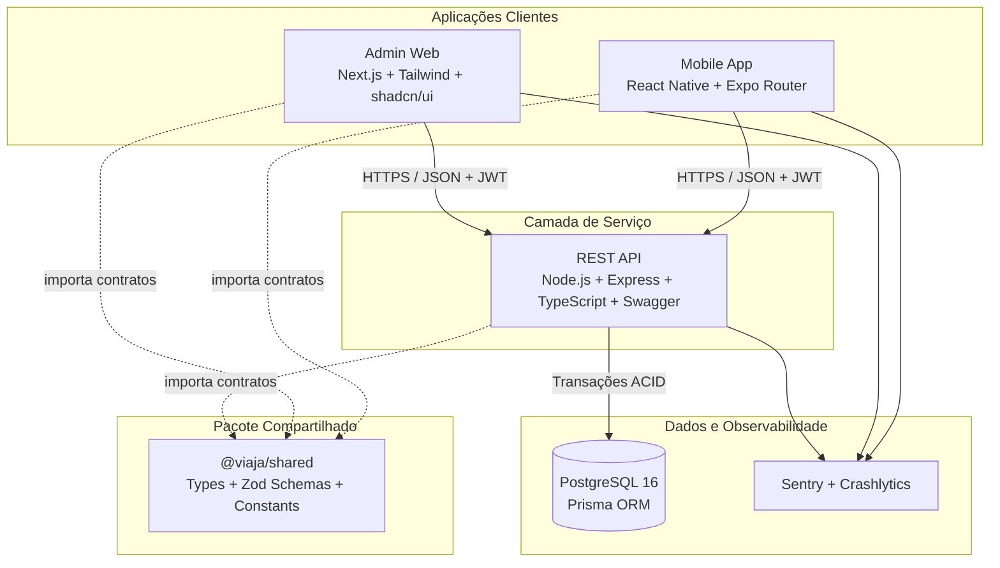

# VIAJA — Arquitetura e Escopo do MVP

## 1. Visão Geral

O **VIAJA** é uma plataforma inteligente de mobilidade rodoviária voltada à pesquisa, reserva e gestão de passagens intermunicipais e interestaduais. O projeto foi concebido como um sistema distribuído em **monorepo TypeScript**, integrando:

- **Aplicação Mobile (`apps/mobile`)**: voltada ao passageiro para busca de viagens, escolha visual de poltronas, compra simulada e carteira de passagens digitais.
- **Aplicação Web Administrativa (`apps/web`)**: voltada à operação para monitoramento de indicadores, gestão de rotas/frota/viagens e administração de reservas.
- **API REST (`backend/api`)**: núcleo de regras de negócio, autenticação/autorização, persistência relacional transacional e controle de concorrência.
- **Pacote Compartilhado (`packages/shared`)**: contratos de tipos, constantes de domínio e schemas de validação (`Zod`) reutilizados entre todas as camadas.

---

## 2. Escopo do MVP e Perfis de Acesso

### 2.1. Perfis do Sistema

| Perfil | Interface Principal | Responsabilidades no MVP |
| :--- | :--- | :--- |
| **Passageiro** (`PASSENGER`) | Mobile (React Native / Expo) | Criar conta, autenticar-se, pesquisar viagens com filtros/ordenação, selecionar assentos disponíveis, concluir checkout simulado (PIX/Cartão), visualizar passagem digital com QR Code e consultar/cancelar reservas próprias elegíveis. |
| **Administrador** (`ADMIN`) | Web (Next.js) | Autenticar-se no painel operacional, acompanhar métricas de negócio no dashboard, cadastrar/editar/remover rotas e viagens, gerenciar disponibilidade e consultar/cancelar reservas administrativamente. |
| **Sistema** (Motor Interno) | Backend + PostgreSQL | Garantir integridade transacional, impedir reservas concorrentes sobre o mesmo assento, expirar reservas pendentes vencidas, calcular valores totais no servidor e sincronizar estados entre `Payment` e `Reservation`. |

### 2.2. Matriz de Priorização do Escopo

- **P0 (Essencial / Bloqueante para MVP)**: Monorepo configurado, PostgreSQL + Prisma, autenticação JWT + RBAC, CRUD de rotas e viagens, busca com filtros, mapa e disponibilidade real de assentos, criação de reserva transacional sem duplicidade, pagamento simulado, passagem digital mobile e painel administrativo web integrado.
- **P1 (Qualidade e Produção)**: Suíte de testes unitários, integração (incluindo concorrência), frontend e E2E (Playwright), documentação OpenAPI/Swagger, CI com GitHub Actions, monitoramento com Sentry e deploy de demonstração.
- **P2 (Evoluções Futuras)**: Firebase Crashlytics com EAS Build, mapas/geolocalização em tempo real, notificações push e gateway de pagamento real em sandbox externo.

### 2.3. Fora do Escopo do MVP

- Processamento financeiro real com adquirentes bancários.
- Emissão fiscal regulatória (BPE / ANTT).
- Venda de passagens com múltiplas conexões/escalas em um único bilhete.

---

## 3. Fluxos Principais do Sistema

### 3.1. Jornada do Passageiro (Mobile)

`Cadastro → Login → Pesquisa → Resultados → Seleção de Assentos → Checkout → Confirmação → Passagem Digital`

1. **Cadastro e Login**: Validação de dados com `Zod`, senha armazenada com hash seguro e sessão persistida em armazenamento criptografado do dispositivo (`Expo SecureStore`).
2. **Pesquisa e Resultados**: Busca por origem, destino e data; filtros complementares (horário, faixa de preço, disponibilidade) e ordenação por menor preço, menor duração ou horário de partida.
3. **Seleção de Assentos**: Consulta em tempo real a `GET /api/trips/:id/seats`. O aplicativo exibe o layout do ônibus com estados `Disponível`, `Selecionado` e `Ocupado`, respeitando limite máximo de poltronas por compra (ex.: até 4 assentos).
4. **Checkout e Confirmação**: Criação de reserva (`POST /api/reservations` em estado `PENDING`) seguida do processamento de pagamento simulado (`POST /api/payments`). Quando `APPROVED`, a reserva transita atomicamente para `CONFIRMED`.
5. **Passagem Digital**: Exibição de código localizador único, QR Code de embarque, dados do passageiro, rota, horários e poltronas, disponível na carteira de viagens.

### 3.2. Jornada Administrativa (Web)

`Login → Dashboard → Gerenciar Rotas → Gerenciar Viagens → Consultar Reservas`

1. **Login Administrativo**: Acesso exclusivo para usuários com `role = ADMIN`, protegido em nível de rota no Next.js e validado por middleware de autorização em cada chamada da API.
2. **Dashboard**: Indicadores reais alimentados pelo backend — total de viagens, total de reservas, receita simulada aprovada, taxa média de ocupação e ranking de rotas/viagens mais procuradas (visualizados com `Recharts`).
3. **Gerenciar Rotas**: Listagem paginada/filtrável, criação, edição e exclusão segura (impedindo remoção física de rotas com viagens vinculadas).
4. **Gerenciar Viagens**: Associação entre `Route` e `Bus`, definição de horários de partida/chegada, preço base e status operacional (`SCHEDULED`, `BOARDING`, `IN_TRANSIT`, `COMPLETED`, `CANCELLED`).
5. **Gerenciar Reservas**: Filtro por viagem, status ou passageiro; inspeção do pagamento associado e cancelamento administrativo auditável com liberação imediata dos assentos.

### 3.3. Fluxo Crítico: Reserva e Pagamento com Controle de Concorrência

---

## 4. Arquitetura do Sistema e Monorepo

### 4.1. Visão de Alto Nível

### 4.2. Organização do Monorepo

| Caminho | Pacote Workspace | Responsabilidade |
| :--- | :--- | :--- |
| `apps/mobile` | `@viaja/mobile` | App do passageiro (Expo Router, TanStack Query, Zustand, React Hook Form). |
| `apps/web` | `@viaja/web` | Painel administrativo (Next.js App Router, shadcn/ui, TanStack Query, Recharts). |
| `packages/shared` | `@viaja/shared` | Schemas `Zod`, tipos inferidos (`z.infer`), DTOs e constantes compartilhadas. |
| `backend/api` | `@viaja/api` | API REST Express modular, Prisma Client, middlewares de segurança e testes de API. |
| `docs/` | — | Documentação arquitetural, banco de dados, design system, protótipos, testes e ADRs. |

### 4.3. Arquitetura Interna do Backend (`backend/api`)

O backend adota **arquitetura modular orientada a domínio**, evitando acoplamento entre recursos:

- **Módulos (`src/modules/`)**: `auth`, `users`, `buses`, `seats`, `routes`, `trips`, `reservations`, `payments`, `dashboard`.
- **Divisão de responsabilidades em cada módulo**:
  - `*.routes.ts`: definição de endpoints Express, documentação OpenAPI e encadeamento de middlewares (`authenticate`, `authorize`, `validate`).
  - `*.controller.ts`: extração de parâmetros HTTP (`req`), delegação para a camada de serviço e formatação da resposta (`res`) com códigos HTTP semânticos.
  - `*.service.ts`: regras puras de negócio, cálculos de preço no servidor, validações de estado e orquestração transacional.
  - `*.repository.ts` (quando aplicável): encapsulamento de consultas complexas ou locks SQL explícitos via Prisma.
- **Tratamento Global de Erros**: classe `AppError` padronizada + `errorHandler` middleware retornando envelope consistente (`{ error: { code, message, details } }`), nunca expondo stack traces em produção.

---

## 5. Justificativa da Stack e Decisões Técnicas (ADRs Iniciais)

### ADR-001 — Monorepo com `pnpm workspaces` e `@viaja/shared`
- **Contexto**: Três aplicações TypeScript (`mobile`, `web`, `api`) consomem os mesmos payloads, filtros e regras de formulário.
- **Decisão**: Centralizar o código em um monorepo `pnpm` com pacote `@viaja/shared` contendo os schemas `Zod` e tipagens de domínio.
- **Justificativa**: Elimina divergência de contratos entre clientes e servidor (*single source of truth*), economiza espaço em disco via content-addressable store do `pnpm` e simplifica pipelines de CI/CD.

### ADR-002 — PostgreSQL + Prisma ORM para Persistência Relacional
- **Contexto**: Venda de assentos exige consistência estrita, integridade referencial entre 8 entidades e suporte robusto a transações concorrentes.
- **Decisão**: Utilizar PostgreSQL gerenciado localmente via Docker Compose e mapeado com Prisma ORM + migrations SQL versionadas.
- **Justificativa**: Bancos relacionais ACID permitem chaves estrangeiras rígidas, locks de linha (`SELECT ... FOR UPDATE`) e índices únicos parciais nativos no PostgreSQL — garantias essenciais para impedir *double booking*.

### ADR-003 — Controle de Concorrência em Duas Camadas (Transação + Constraint de Banco)
- **Contexto**: Dois passageiros podem visualizar o mesmo assento livre e enviar `POST /api/reservations` no mesmo milissegundo.
- **Decisão**: Combinar transação explícita com lock pessimista nos assentos solicitados **e** índice único parcial no PostgreSQL para reservas ativas (`PENDING` ou `CONFIRMED`), aliado à expiração automática (`expiresAt`) de reservas `PENDING`.
- **Justificativa**: Não depende do estado visual do frontend nem apenas de verificações `SELECT` antes de `INSERT` em nível de aplicação (sujeitas a *race conditions*).

### ADR-004 — Separação entre Estado de Servidor (TanStack Query) e Estado de UI (Zustand)
- **Contexto**: A disponibilidade de assentos muda externamente a qualquer instante, enquanto dados da seleção atual no checkout e sessão pertencem à interação local.
- **Decisão**: Adotar **TanStack Query** para cache, revalidação em foco e mutações de API (tanto no Mobile quanto na Web) e **Zustand** no Mobile apenas para estado efêmero de UI/fluxo de compra e sessão.
- **Justificativa**: Evita stores globais inchadas com dados obsoletos da API e garante revalidação automática do mapa de assentos ao retomar a tela.

### ADR-005 — Express + TypeScript no Backend com Swagger/OpenAPI
- **Contexto**: Necessidade de uma API REST clara, testável com `Supertest`, bem documentada e desacoplada dos clientes.
- **Decisão**: Construir a API com Node.js + Express + TypeScript, validação via middlewares `Zod` e especificação OpenAPI 3.0 servida via Swagger UI (`/api/docs`).
- **Justificativa**: Ecossistema maduro, controle explícito sobre middlewares HTTP/transações, excelente integração com Supertest e curva direta de leitura para avaliadores técnicos.
