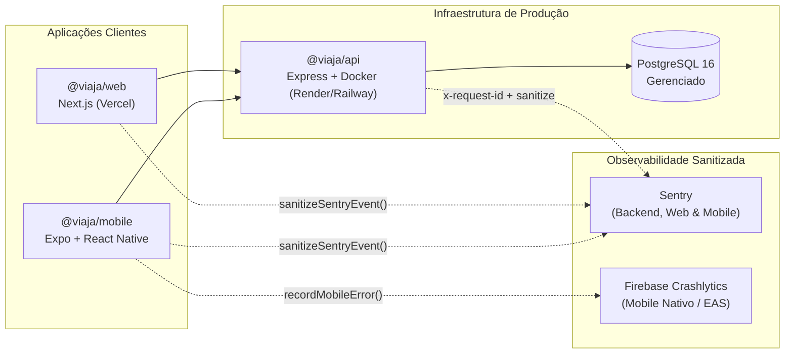

# VIAJA — Monitoramento, CI/CD e Preparação de Deploy

## 1. Visão Geral

Esta documentação consolida a arquitetura de observabilidade, automação de qualidade contínua e empacotamento para produção implementada na **Fase 7** do projeto **VIAJA**.



---

## 2. Monitoramento de Erros e Privacidade (Passos 34 e 35)

### 2.1. Sanitização Compartilhada (`@viaja/shared`)

Antes de qualquer evento deixar o Backend, Web ou Mobile, o módulo [`packages/shared/src/telemetry/index.ts`](../packages/shared/src/telemetry/index.ts) aplica:

- **`sendDefaultPii: false`** em todas as instâncias do Sentry.
- **Redação recursiva (`[REDACTED]`)** de chaves sensíveis: `password`, `passwordHash`, `token`, `accessToken`, `refreshToken`, `Authorization`, `Cookie`, `cardNumber`, `cvv`, `cpf`, `email` e `ip_address`.
- **Scrubbing textual** de padrões `Bearer <token>`, JWTs (`eyJ...`) e parâmetros de query sensíveis.
- **Minimização de escopo do usuário**: apenas `id` e `role` (`PASSENGER` | `ADMIN`) são vinculados ao contexto de diagnóstico — nunca e-mail, nome completo ou credenciais.

### 2.2. Sentry (Backend, Web e Mobile)

| Camada                       | SDK                    | Arquivo Principal                                                                       | Escopo Capturado                                                                                                                      |
| :--------------------------- | :--------------------- | :-------------------------------------------------------------------------------------- | :------------------------------------------------------------------------------------------------------------------------------------ |
| **Backend (`@viaja/api`)**   | `@sentry/node`         | [`backend/api/src/config/sentry.ts`](../backend/api/src/config/sentry.ts)               | Exceções `5xx` no `errorHandler`, `unhandledRejection`, `uncaughtException`, correlação por header `x-request-id` e breadcrumbs HTTP. |
| **Web (`@viaja/web`)**       | `@sentry/nextjs`       | [`apps/web/src/lib/monitoring.ts`](../apps/web/src/lib/monitoring.ts)                   | Error Boundaries (`error.tsx` e `global-error.tsx`), falhas de rede (`NETWORK_ERROR`) e respostas `5xx` no cliente HTTP.              |
| **Mobile (`@viaja/mobile`)** | `@sentry/react-native` | [`apps/mobile/src/services/monitoring.tsx`](../apps/mobile/src/services/monitoring.tsx) | `MobileErrorBoundary` global, falhas de rede/servidor em `apiRequest` e rastreamento de sessão.                                       |

### 2.3. Firebase Crashlytics no Mobile (Expo + Builds Nativos)

A integração em [`apps/mobile/app.config.ts`](../apps/mobile/app.config.ts) e [`apps/mobile/src/services/monitoring.tsx`](../apps/mobile/src/services/monitoring.tsx) foi projetada para funcionar em dois modos complementares:

1. **Builds Nativos (`EAS Development` / `Preview` / `Production`)**:
   - Configura `expo-build-properties` (`ios.useFrameworks: "static"`) e ativa automaticamente os plugins `@react-native-firebase/app` e `@react-native-firebase/crashlytics` quando os arquivos `google-services.json` / `GoogleService-Info.plist` são injetados via **EAS Secrets** (sem jamais versionar chaves no Git).
   - Registra falhas não-fatais (`recordError`), logs de contexto (`log`), atributos sanitizados (`setAttributes`) e crashes nativos.
2. **Desenvolvimento JS / Expo Go / Testes (`Jest`)**:
   - Detecta a ausência do binário nativo `RNFBCrashlyticsModule` e aciona um adaptador de diagnóstico em memória (`getMobileDiagnosticEvents()`), evitando falhas de inicialização no Expo Go.
   - Na aba **Perfil** (em ambientes `development`/`preview`), o botão **"Testar captura de falha"** executa `runMonitoringDiagnosticCheck('non_fatal')`, permitindo validar empiricamente a captura e a sanitização em desenvolvimento e em builds de teste distribuídos.

---

## 3. Pipeline de CI/CD — GitHub Actions (Passo 36)

O workflow [`.github/workflows/ci.yml`](../.github/workflows/ci.yml) é executado automaticamente em **Pull Requests** (`main`, `develop`) e pushes em `main`, estruturado em 4 jobs:

1. **`changes` (Verificação de Alterações)**: utiliza `dorny/paths-filter` para identificar quais pacotes do monorepo foram alterados (`@viaja/shared`, `@viaja/api`, `@viaja/web`, `@viaja/mobile`, `infra`) e publica resumo no GitHub Actions.
2. **`quality-and-unit` (Qualidade Estática & Testes Unitários/Frontend)**:
   - Instalação determinística (`pnpm install --frozen-lockfile` + cache).
   - Geração do cliente Prisma (`db:generate`).
   - Verificação de tipos (`pnpm typecheck`), `ESLint` (`pnpm lint`) e `Prettier` (`pnpm format:check`).
   - Testes unitários de domínio/contratos (`pnpm test:unit`), testes de componentes Mobile (`Jest`) e Web (`Vitest`).
3. **`integration-tests` (Integração & Concorrência com PostgreSQL 16)**:
   - Sobe um container de serviço `postgres:16-alpine` real com _healthcheck_.
   - Aplica migrations (`prisma migrate deploy`) no banco `viaja_test`.
   - Executa a suíte `Supertest` incluindo o teste de **10 requisições simultâneas disputando o mesmo assento**.
4. **`build-web` (Build de Produção)**:
   - Valida o build completo do backend e da aplicação Next.js (`pnpm --filter @viaja/web run build`).

---

## 4. Preparação de Deploy (Passo 37)

### 4.1. Banco de Dados — PostgreSQL Gerenciado (Render / Neon / Supabase / Railway)

- Versão alvo: **PostgreSQL 16** com conexões TLS (`?sslmode=require` em produção).
- Aplicação automática de schema e índice parcial `uq_active_trip_seat` via `pnpm --filter @viaja/api run db:migrate:deploy`.

### 4.2. Backend API — Container Node.js (`Render` / `Railway` / `Fly.io`)

- **Container**: [`backend/api/Dockerfile`](../backend/api/Dockerfile) multi-stage baseado em `node:20-alpine`, executando como usuário não-root (`node`), com `HEALTHCHECK` apontando para `GET /api/health`.
- **Blueprint IaC**: [`render.yaml`](../render.yaml) provisiona em conjunto o banco `viaja-postgres` e o serviço web `viaja-api` com segredos JWT gerados automaticamente.
- Variáveis obrigatórias em produção: `DATABASE_URL`, `JWT_ACCESS_SECRET`, `JWT_REFRESH_SECRET`, `CORS_ORIGIN` (domínio da Vercel) e `SENTRY_DSN` (opcional).

### 4.3. Aplicação Web — Vercel

- Configuração pronta em [`apps/web/vercel.json`](../apps/web/vercel.json) com headers de segurança (`X-Content-Type-Options`, `X-Frame-Options`, `Referrer-Policy`).
- No painel da Vercel:
  - **Root Directory**: `apps/web` (com `Install Command`: `pnpm install --frozen-lockfile` na raiz do monorepo).
  - **Environment Variables**: `NEXT_PUBLIC_API_URL=https://<sua-api>/api` e `NEXT_PUBLIC_SENTRY_DSN=<dsn>`.

### 4.4. Aplicativo Mobile — Expo EAS Build & Distribuição de Testes

- Perfis configurados em [`apps/mobile/eas.json`](../apps/mobile/eas.json):
  - **`development`**: `developmentClient: true` para depuração com módulos nativos (Crashlytics + Sentry).
  - **`preview`**: distribuição interna (`distribution: "internal"`) gerando **APK instalável direto no Android** (`buildType: "apk"`) e build ad-hoc iOS para avaliadores e testes de campo:
    ```bash
    cd apps/mobile
    npx eas-cli build --profile preview --platform android
    ```
  - **`production`**: incremento automático de versão para publicação nas lojas.
