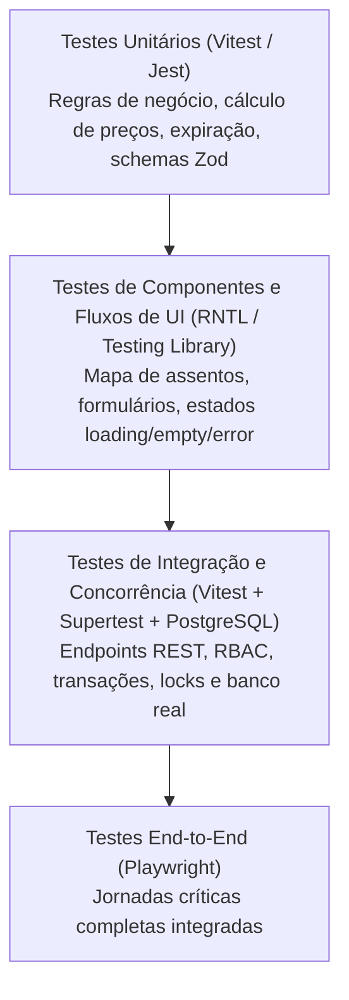

# VIAJA — Estratégia de Testes Automatizados

## 1. Objetivos da Estratégia de Qualidade

A estratégia de testes do **VIAJA** foi desenhada para proteger os fluxos críticos de compra, integridade financeira/operacional e controle de acesso, evitando testes frágeis focados em detalhes internos de implementação.

Os pilares centrais são:

1. **Confiabilidade Transacional**: provar de forma determinística que duas requisições simultâneas nunca reservam a mesma poltrona.
2. **Segurança e Autorização**: assegurar que rotas administrativas (`ADMIN`) e recursos privados de outros passageiros estejam devidamente blindados.
3. **Contratos Compartilhados**: validar schemas `Zod` em `@viaja/shared` garantindo paridade entre Mobile, Web e Backend.
4. **Experiência Ponta a Ponta**: validar a jornada real do usuário do login à emissão da passagem e gestão administrativa.

---

## 2. Pirâmide de Testes e Ferramentas

| Camada                              | Escopo                                                                                                                                      | Ferramentas                             | Onde Reside                                 |
| :---------------------------------- | :------------------------------------------------------------------------------------------------------------------------------------------ | :-------------------------------------- | :------------------------------------------ |
| **Unitários (Shared & Backend)**    | Schemas `Zod`, regras puras de domínio, cálculo de tarifas, elegibilidade de cancelamento, expiração de reserva e geração/validação de JWT. | `Vitest`                                | `packages/shared`, `backend/api/tests/unit` |
| **Integração & Concorrência (API)** | Ciclo HTTP completo Express → Service → Prisma → PostgreSQL isolado de teste.                                                               | `Vitest` + `Supertest`                  | `backend/api/tests/integration`             |
| **Componentes Mobile**              | Renderização de telas, formulários (`React Hook Form`), seleção de poltronas e estados visuais.                                             | `Jest` + `React Native Testing Library` | `apps/mobile/src/**/__tests__`              |
| **Componentes Web**                 | Cards/gráficos de KPIs, tabelas administrativas, formulários de CRUD e proteção de sessão.                                                  | `Vitest` + `@testing-library/react`     | `apps/web/src/**/__tests__`                 |
| **End-to-End (E2E)**                | Jornada integrada navegador ↔ API ↔ banco de dados.                                                                                         | `Playwright`                            | `apps/web/e2e` (ou `e2e/`)                  |

---

## 3. Cenários Críticos por Camada

### 3.1. Testes Unitários (`backend/api` & `packages/shared`)

- **Autenticação**: hash de senha nunca armazena texto puro; tokens expirados ou assinados com segredo inválido são rejeitados.
- **Validação (`Zod`)**: rejeição de datas passadas na criação de viagens, `arrivalAt <= departureAt`, lista vazia de assentos ou excesso acima do limite permitido por compra.
- **Cálculo de Preços**: `totalPrice` calculado exclusivamente a partir do preço oficial da viagem/assento no servidor (ignorando qualquer valor enviado pelo cliente).
- **Regras de Cancelamento**: bloqueio de cancelamento de viagens já concluídas (`COMPLETED`) ou reservas já canceladas; atualização coerente do pagamento (`REFUNDED` quando aplicável).
- **Expiração de Reservas**: reservas `PENDING` com `expiresAt < now()` são tratadas como expiradas e liberam os assentos.

### 3.2. Testes de Integração (`Supertest` + Banco de Teste)

Executados contra uma instância real do PostgreSQL (schema/banco de teste limpo entre suítes):

- **`/api/auth`**: registro de novo passageiro (`201`), tentativa de e-mail duplicado (`409`), login válido (`200`), credenciais inválidas (`401`), refresh de sessão e `/me` autenticado.
- **`/api/routes` & `/api/trips`**:
  - Listagem pública/autenticada com filtros combinados (`origin`, `destination`, `date`, `minPrice`, `maxPrice`, `onlyAvailable`).
  - Bloqueio com `403 Forbidden` quando um `PASSENGER` tenta criar, editar ou excluir rotas/viagens.
- **`/api/reservations` & `/api/payments`**:
  - Criação de reserva válida (`201`), consulta do mapa `GET /api/trips/:id/seats` refletindo imediatamente o assento como `OCCUPIED`.
  - Simulação de pagamento `PIX` / `CREDIT_CARD` aprovando (`APPROVED` → `CONFIRMED`) ou recusando (`REJECTED`).
  - Cancelamento liberando novamente o assento no mapa da viagem.

### 3.3. Teste Específico de Concorrência (Obrigatório)

Para validar o requisito central de integridade do **VIAJA**:

1. Preparar uma viagem ativa com o assento `12` disponível.
2. Autenticar `N` passageiros distintos (ex.: `5` ou `10` usuários).
3. Disparar simultaneamente via `Promise.all` requisições `POST /api/reservations` solicitando o mesmo `{ tripId, seatIds: [seat12.id] }`.
4. **Asserções obrigatórias**:
   - Exatamente **1** requisição responde `201 Created`.
   - Exatamente **N - 1** requisições respondem `409 Conflict`.
   - No banco de dados, existe apenas **1** registro em `reservation_seats` com `is_active = true` para `(tripId, seat12.id)`.

### 3.4. Testes de Frontend

#### Mobile (`React Native Testing Library`)

- **Formulários de Auth e Pesquisa**: exibição de mensagens de validação `Zod` antes do disparo de rede.
- **Mapa de Assentos**:
  - Assentos `OCCUPIED` ficam desabilitados ao toque.
  - Toque em assento `AVAILABLE` alterna para `SELECTED` e recalcula o resumo financeiro.
  - Respeito ao limite máximo de assentos selecionáveis por reserva.
- **Estados Visuais**: verificação explícita de `Loading` (skeleton/spinner), `Empty State` (nenhuma viagem encontrada) e `Error State` (falha na API com botão de nova tentativa).

#### Web (`Testing Library`)

- **Dashboard**: renderização correta dos indicadores numéricos (viagens, reservas, receita, taxa de ocupação) a partir dos mocks da API.
- **Formulários Administrativos**: criação/edição de rotas e viagens validando campos obrigatórios, preços e horários.
- **Gestão de Reservas**: filtragem por viagem e confirmação antes do cancelamento administrativo.

### 3.5. Testes End-to-End (`Playwright`)

Validação automatizada das jornadas completas em navegador real:

1. Acessar a aplicação e realizar autenticação.
2. Executar fluxo operacional administrativo (cadastrar rota/viagem e visualizar no dashboard) e/ou fluxo completo de consulta, seleção de assento, pagamento simulado e confirmação de reserva conforme escopo E2E.
3. Verificar persistência após recarregamento da página e proteção de rotas não autenticadas.

---

## 4. Isolamento de Dados e Execução em CI/CD

- **Isolamento**: Nenhum teste automatizado depende de APIs externas; o banco de testes roda em container PostgreSQL efêmero (local via Docker Compose e no GitHub Actions via `services: postgres`).
- **Determinismo**: Datas relativas nos seeds de teste são geradas dinamicamente no futuro (`now + X dias`) para que testes nunca quebrem com a passagem do tempo.
- **Pipeline GitHub Actions (Pull Requests)**:
  1. `pnpm install --frozen-lockfile`
  2. `pnpm lint` & `pnpm typecheck`
  3. `pnpm --filter @viaja/shared test`
  4. `pnpm --filter @viaja/api test:unit` & `test:integration` (com migrations Prisma aplicadas no Postgres de CI)
  5. `pnpm --filter @viaja/mobile test` & `pnpm --filter @viaja/web test`
  6. `pnpm --filter @viaja/web build`

---

## 5. Critérios de Pronto (Definition of Done de Qualidade)

Nenhuma funcionalidade é considerada concluída sem:

- [ ] Tipagem estrita em TypeScript (`strict: true`, zero `any` injustificado).
- [ ] Validação de entrada tanto no cliente quanto no servidor.
- [ ] Cobertura dos caminhos felizes **e** caminhos de erro/borda nas regras de negócio.
- [ ] Todos os testes existentes e novos passando localmente e no pipeline de CI.
